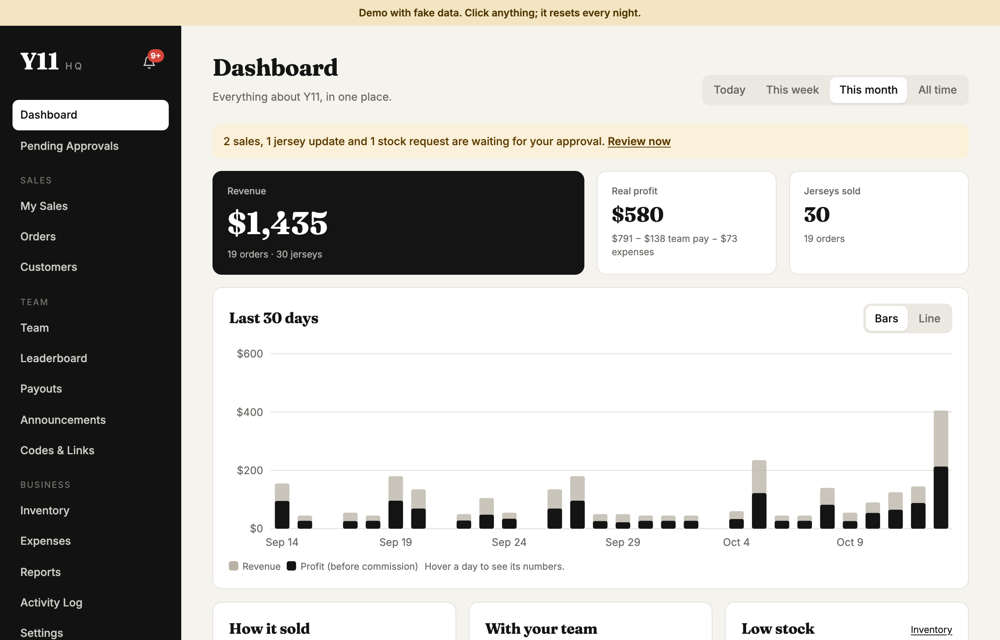
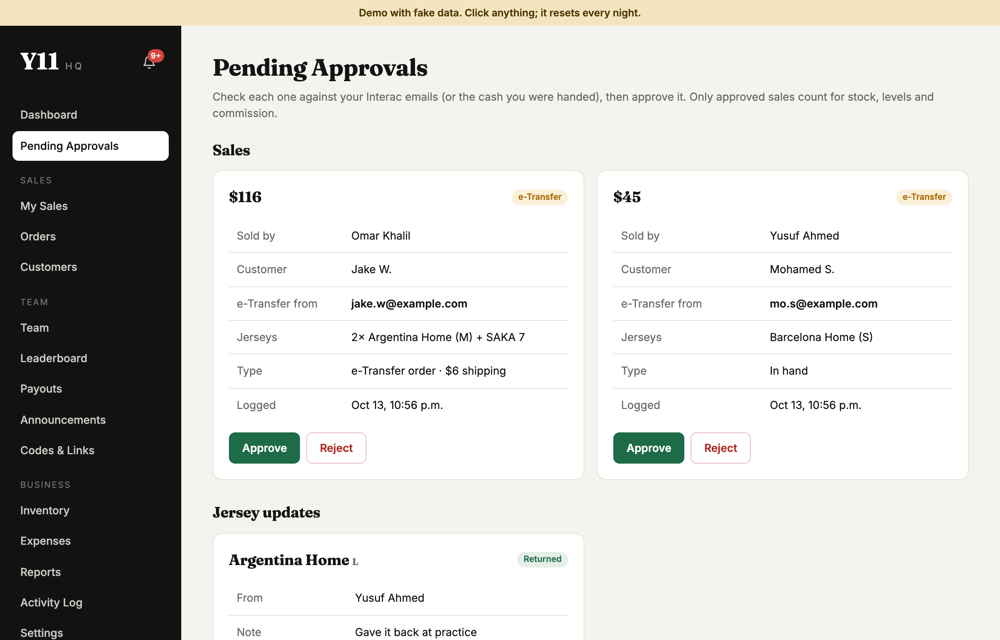
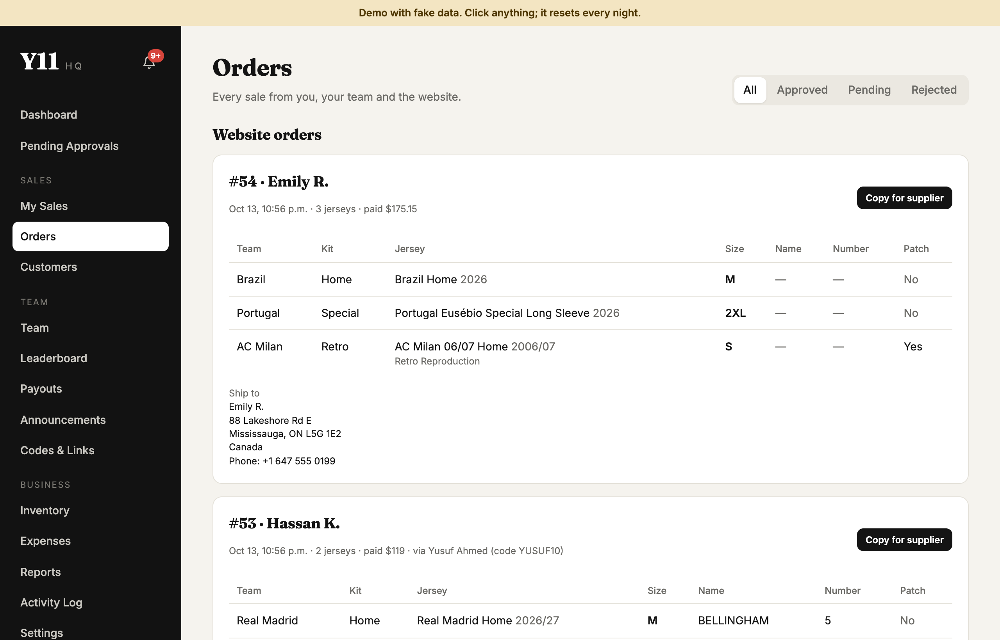
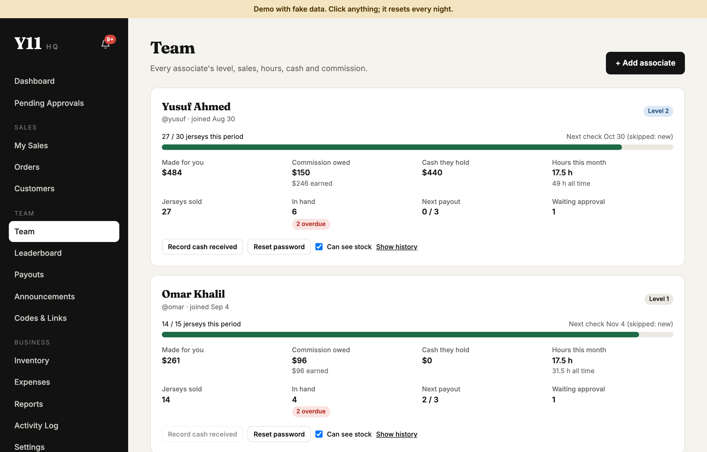
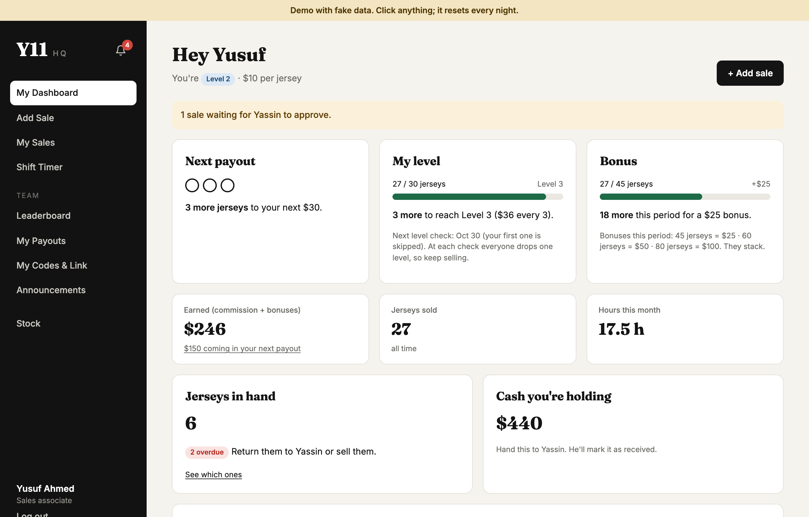
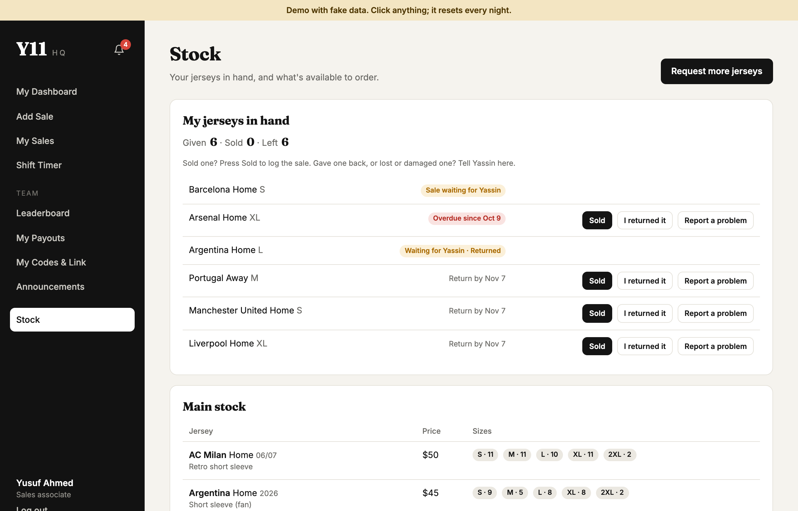

# Y11 HQ

The back office I built for **Y11 Jerseys**, a football jersey business in Toronto. It runs the sales team (commission, levels, payouts), stock, approvals and every order, including the ones from the online shop. It's in production for the real business.

**Live demo: https://y11-hq-demo-production.up.railway.app**
Click **Try the CEO view** or **Try the associate view**. It uses fake data and resets every night, so click anything.



## What I built

- **One app, two very different views.** The CEO sees revenue, profit, stock and the whole team. Sales associates see only their own sales, level, commission and hours. Permissions are enforced on the server: associates never receive a cost or profit field in any response, and a test checks every key they get back.
- **A commission and level engine.** Associates earn a payout for every 3 jerseys ($24 / $30 / $36 by level), level up the moment they hit 15 or 30 jerseys in a 2-month period, and drop a level at each check. The rules are pure functions with unit tests, including a level-up in the middle of a commission set.
- **Approvals that can't drift out of sync.** Associates log e-Transfer and cash sales; nothing counts until the CEO approves. Approval is one database transaction with row locks, so stock, commission, levels and cash owed all change together or not at all, even with two approvals at the same moment.
- **The online shop feeds it.** The storefront is a separate app with Stripe Checkout. Its signature-verified Stripe webhook forwards each paid order to HQ over a key-protected API. Recording is idempotent, keyed on the Stripe session, so webhook retries can never double-count a sale. The associate whose promo code or referral link brought the order is credited exactly like their own sale, and HQ turns the order into a ready-to-send supplier list and emails it.
- **Everyday tools for a small team:** jersey returns and losses with CEO approval, stock requests, payouts with itemised statements, milestone bonuses, a leaderboard, notifications, expenses, customers, CSV reports, and a shift timer that ends forgotten shifts.
- **Shipped and running.** Dockerized with a multi-stage build that runs as a non-root user, deployed on Railway with health checks. Login attempts are rate-limited per user and network. That limit passed every test but failed behind the real proxy, so I debugged it against the live deployment and switched to the platform's trusted client-IP header. The server refuses to start with default secrets, and the production database can be reset from inside the platform without ever being made public.
- **92 automated tests** with Vitest and Supertest against a real PostgreSQL database: unit tests for pricing, commission and levels, and end-to-end HTTP tests for every flow.

## Screenshots

| | |
|---|---|
|  |  |
| **Pending approvals:** sales, jersey updates and stock requests | **Website orders,** ready to copy to the supplier |
|  |  |
| **Team:** levels, commission, cash held, hours | **Associate dashboard:** next payout, level, bonus |
|  | |
| **An associate's jerseys:** sell, return or report a problem | |

## How it fits together

```
 Online shop (separate app)                          Y11 HQ (this repo)
 ┌─────────────────────────────────┐   paid order    ┌────────────────────────────────┐
 │ Checkout ──► Stripe              │ ──────────────► │ React app                      │
 │ Stripe webhook (signature check) │  key-protected  │ Express API                    │
 │ Promo code / ?ref= link checks   │ ◄────────────── │   routes   → validate input    │
 └─────────────────────────────────┘                  │   services → DB transactions   │
                                                       │   domain   → pure rules        │
                                                       │ PostgreSQL                     │
                                                       └────────────────────────────────┘
```

## Engineering decisions

- **Business rules are pure functions** (`server/src/domain/`), separate from database code, so they're fast to test and safe to change.
- **Money is `NUMERIC(10,2)`**, never floating point. Prices are copied onto each sale line, so changing a price never rewrites history.
- **The database enforces rules too:** `CHECK (stock >= 0)`, plus partial unique indexes for "one open shift per person" and "one pending update per jersey".
- **Idempotent by design:** scheduled jobs only act when a deadline has passed, and website orders are recorded once per Stripe session.
- **Security basics done properly:** bcrypt, signed JWTs in httpOnly, Secure, SameSite cookies, removed users locked out on their next request, and the shared API key compared in constant time.

## Tech

TypeScript · Node.js · Express 5 · PostgreSQL · React · Vite · Zod · Vitest + Supertest · Docker · Railway

## Run it locally

With Docker:

```bash
cp server/.env.example server/.env   # set OWNER_PASSWORD (10+ characters) and JWT_SECRET
docker compose up --build            # then open http://localhost:8080
```

Or with Node.js 20+ and PostgreSQL:

```bash
createdb y11hq && createdb y11hq_test
cp server/.env.example server/.env
npm install
npm run db:setup
npm run dev                          # http://localhost:5173
npm test
```

With `SEED_DEMO_DATA=true`, you can log in as the CEO (`yassin` with your `OWNER_PASSWORD`) or as the demo associates `yusuf`, `omar` and `adam` (password `demo1234`).

## Project layout

```
server/src/
  domain/      Business rules as pure functions (pricing, commission, levels) + unit tests
  services/    Database work: sales, levels, website orders, jersey updates, stock requests, jobs
  routes/      HTTP endpoints, grouped by screen
  db/          schema.sql, migrations, demo data
client/src/
  pages/       One file per screen
  components/  Shared pieces: tables, stats, the hand-drawn chart, the Add Sale form
```

---

This is a public copy of a private repository. The demo data and the supplier costs in the code are made up.
